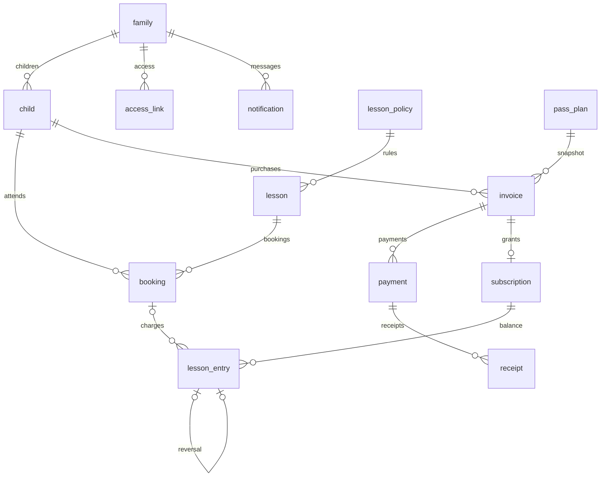

# Архитектура Ясны

Предложение для трех начинающих разработчиков. Python + Django 5.2 LTS
(последний исправленный выпуск ветки), PostgreSQL, Django Templates и Bootstrap.
HTML формируется сервером. Первую версию делаем обычными формами без собственного JS.
Django Admin используем для настройки и первоначального ввода данных;
для посещаемости и родителя делаем отдельные удобные страницы.

## Устройство приложения

Браузер → Django URLs/Views/Forms → сервисы бизнес-операций → ORM → PostgreSQL.
ЮKassa → отдельный обработчик подтверждений → сервис оплаты.
Чеки хранятся в закрытом постоянном каталоге; скачивание через проверку доступа.

Приложения Django:
- accounts: семьи, дети, ссылки доступа, отдельный вход мастера;
- scheduling: правила, занятия, записи, посещаемость;
- billing: тарифы, счета, оплаты, абонементы, движения занятий, чеки;
- notifications: сообщения кабинета;
- core: история изменений, общие шаблоны, команды экспорта и демоданных.

Каждый разработчик подключает собственную локальную базу PostgreSQL 17.
Django можно запускать из виртуального окружения Python. На сервере нужны
HTTPS, рабочий сервер приложения, постоянные тома базы и файлов.
Не использовать Django runserver для публичного размещения.
Резервируем PostgreSQL и каталог чеков; проверяем восстановление в отдельную базу.
Периодические напоминания: management command по расписанию, без Celery на первом этапе.

## Физическая модель

schema.sql содержит 14 прикладных таблиц PostgreSQL, типы, PK, FK, CHECK,
UNIQUE и индексы. Обязательные поля имеют NOT NULL; остальные допускают NULL.
Время событий — timestamptz, деньги — numeric(12,2), ключи — bigint identity.
Служебные таблицы пользователей мастера, прав, сессий и миграций создает Django.
DDL — самостоятельный проект схемы, а не готовая миграция Django.
При реализации переносим схему в models.py и делаем migrations; SQL вручную
поверх Django-базы не выполняем. Таблицы Django могут получить префиксы приложений.

audit_event — общий журнал до/после. Его entity_type/entity_id — логическая
ссылка, не FK; доступ на изменение журнала пользователям не предоставляется.
Идентичность автора проверяется сервером; actor_label заполняется из сессии.

## Обязательные правила сервисов

Ограничения ниже не обеспечиваются одним DDL. Нужны транзакции и тесты.

1. Запись: transaction.atomic + select_for_update строки lesson, затем проверка
   статуса, времени, вместимости и активных записей. Все пути записи и изменения
   вместимости используют эту блокировку. При повторной записи восстанавливаем
   существующую строку booking. Перенос атомарно отменяет старую и создает новую
   запись с проверкой обеих групп; блокируем занятия в порядке id.
2. Посещение: блокируем booking и subscription; повторная отметка ничего не
   списывает. Проверяем ребенка, срок и остаток абонемента. Сохраняем посещение,
   движение и audit_event одной транзакцией. Исправление создает обратное движение,
   а не удаляет старое. Обратное движение должно иметь противоположную delta,
   тот же абонемент и ту же запись. Эти межстрочные проверки выполняет сервис.
3. Оплата: сервер проверяет статус у провайдера, сумму, валюту и принадлежность
   платежа счету. Блокируем счет и платеж. Повторное подтверждение уже успешного
   платежа ничего не начисляет. Когда счет полностью оплачен, один раз создаем
   subscription и выдачу +N. Сетевой запрос провайдеру выполняем до короткой
   транзакции. operation_key сохраняем и повторно используем при сетевом повторе.
4. Баланс денег семьи = сумма успешных оплат минус сумма неотмененных счетов.
   Отрицательная сумма означает долг. Остаток занятий = SUM(lesson_entry.delta).
   Не складывать деньги и занятия. В MVP платеж относится к одному счету;
   свободный депозит и распределение платежа по счетам не поддерживаются.
5. Любой запрос родителя фильтруется по family_id сессии, включая скачивание чеков.
   Храним только хеш случайного секретного токена. После входа выдаем HttpOnly
   Secure cookie; сессия хранит access_link_id. Каждый запрос проверяет срок
   и отзыв ссылки, чтобы отзыв закрывал и действующие сессии.
6. Правила отмен версионируем: используем новую строку lesson_policy, не меняем
   задним числом примененные правила. Отмена мастером возвращает списания.
   История и финансовые записи не удаляются; ошибочные операции исправляются явно.
7. Все формы защищены CSRF. Исключение — webhook, где нужны проверки провайдера.
   Ограничиваем попытки входа и размер/тип чеков. Секретные ссылки не логируем.

## Допущения, которые нужно согласовать с заказчиком

- Мастер создает семью и передает ссылку; публичной самостоятельной регистрации пока нет.
- Абонемент принадлежит одному ребенку; общий абонемент на семью не предусмотрен.
- Срок начинается в день полной оплаты, даты считаются по Asia/Yekaterinburg.
- Посещение без действующего абонемента требует явного решения мастера и счета
  за разовое занятие; автоматический отрицательный остаток не допускается.
- Возвраты денег и свободные авансы требуют расширения модели, они не реализованы.

## Работа втроем

Участник 1: каркас, accounts/core, модели и миграции, окружение, интеграция.
Участник 2: scheduling, расписание, журнал и интерфейс мастера.
Участник 3: billing/notifications, кабинет родителя, тестовые платежи и чеки.
У третьего самая сложная интеграция: после готовности основного сценария
первый помогает с проверкой платежей, второй — с версткой кабинета.

Сначала вместе поднимаем пустое приложение у всех и согласуем модели.
Один участник интегрирует изменения схемы; остальные не меняют общие модели
молча. У каждого отдельная локальная БД с одинаковыми вымышленными демоданными.

## GitHub

1. Владелец добавляет двух участников в Collaborators. Каждый клонирует репозиторий.
2. main содержит запускаемую версию. На каждую небольшую задачу — Issue и ветка
   feat/booking, feat/parent-cabinet и т.п.; не делать вечные ветки по людям.
3. Обновить main, создать ветку, внести изменение, проверить, commit, push,
   открыть Pull Request. Другой участник просматривает и запускает проверку.
4. После принятия объединить в main, удалить ветку; остальные обновляют main
   и применяют миграции. Не объединять сразу несколько огромных незаконченных веток.
5. В PR написать: что работает, как проверить, какие миграции и ограничения есть.
6. Коммитить миграции, зависимости с фиксированными версиями, .env.example,
   инструкции запуска и команду demo_data.
7. Не коммитить .env, пароли, токены, .venv, базы, чеки и реальные данные семей.
8. GitHub Actions: PostgreSQL для тестов, migrate, check,
   makemigrations --check --dry-run и test. Проверка должна выполняться на каждом PR.

Для каждой задачи задавайте GPT общий стек, ссылку/текст архитектуры,
текущие модели, точную задачу и критерий готовности. Не просите каждого GPT
сгенерировать приложение целиком: получите три несовместимых проекта.

## Порядок сборки

1. Каркас, база, миграции, Django Admin, демосемья и демозанятие.
2. Запись и ограничение вместимости, доступ семьи, оба простых кабинета.
3. Ручная оплата, выдача 4 занятий, посещение, остаток 3, история исправлений.
4. ЮKassa в тестовом режиме, обработка дублей, прикрепление и просмотр чека.
5. Уведомления, правила отмен, CSV, резервная копия и восстановление.
6. Развертывание, мобильный интерфейс, репетиция сценария защиты.

Критические тесты: две конкурентные заявки на последнее место; чужая семья
не видит данные/чеки; повторный webhook не выдает второй абонемент;
исправление посещения возвращает ровно одно занятие; отзыв ссылки закрывает сессию.

Статус: схема спроектирована, но не применена к серверу PostgreSQL.
Проект SQL служит основой для будущих миграций прикладных моделей.
